# Dev Guru

**See your code. Understand it. Change it with confidence.**

Point Dev Guru at a Python project and get **one offline HTML explorer**:
- a living constellation of packages and files;
- the flow of dependencies;
- the blast radius of a change;
- who calls what, and where the hotspots are;
- a guided tour, with the source one click away.

Everything is computed locally by [Ananke Plexus](https://neo-pragnya.github.io/Ananke-Plexus/), and the report is
a single file you can share like a PDF.

```bash
pip install dev-guru
dev explore path/to/project -o explorer.html --open
```



**[Documentation and a live demo →](https://neo-pragnya.github.io/Dev-Guru/)**: the site's hero runs the real
report of Dev Guru exploring its own source.

## What's in a report

| View | Question it answers |
| --- | --- |
| ✦ Constellation | What's here? Files clustered by package; hover to light up imports |
| ⇶ Flow | What depends on what? Entry side to foundations; cycles glow rose |
| ◎ Impact | What breaks if this changes? Blast-radius rings over importers and callers |
| ƒ Calls | Who calls in, and what goes out? A symbol-level ego network |
| ▦ Hotspots | Where is change expensive? A treemap of size against how depended-on a file is |
| ☄ Tour | Show me around: a narrated walk through the codebase |

Plus search (`/`), a command palette (`Ctrl`/`⌘` `K`), a source inspector, a light and dark theme, and shareable
URLs. Reports are **offline and view-only**, treat source as text, and carry a manifest with the input digest and the
Git revision. See [report safety](docs/concepts/report-safety.md).

## From Python

```python
from dev_guru import GuruClient

with GuruClient(workspace="path/to/project") as guru:
    result = guru.explore()
    guru.export(result, output="explorer.html")
```

## How it fits together

| Repository | Role |
| --- | --- |
| **Dev Guru** (this repo) | The product: CLI and SDK, report view models and renderers, later a local web UI |
| [Ananke Plexus](https://github.com/Neo-Pragnya/Ananke-Plexus) | The harness: code graph, analysis, workflows, policy, runs and evidence |
| [Dex Trove](https://github.com/Neo-Pragnya/Dex-Trove) | Optional capability memory: curated skills, agents, instructions and workflows |

Dev Guru never analyses code itself: every domain operation goes through one client port to Ananke, and Dex is never
required. See [Architecture](docs/concepts/architecture.md) and [ADR-0001](docs/decisions/0001-ananke-client-port.md).

## Quality gates

```bash
make verify             # ruff, ruff format, strict mypy, pytest
make acceptance-wheel   # capability scenarios on the built wheel, including real-Chrome report journeys
make scan               # gitleaks, pip-audit, GuardDog and Bandit on dist/
```

## Licence

Apache-2.0. See [LICENSE](LICENSE).
