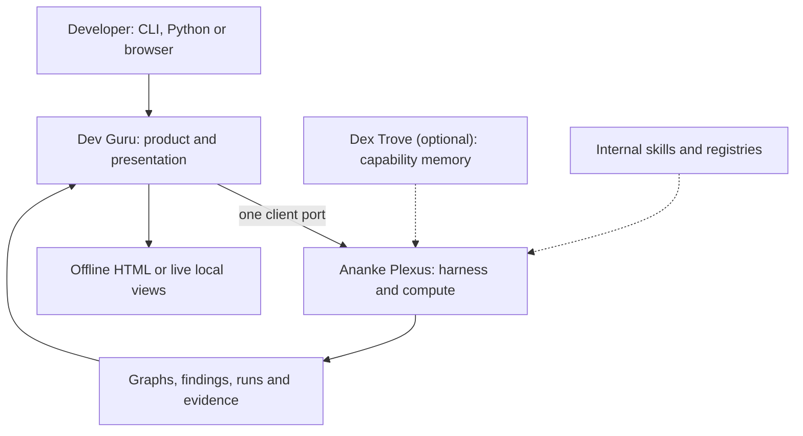
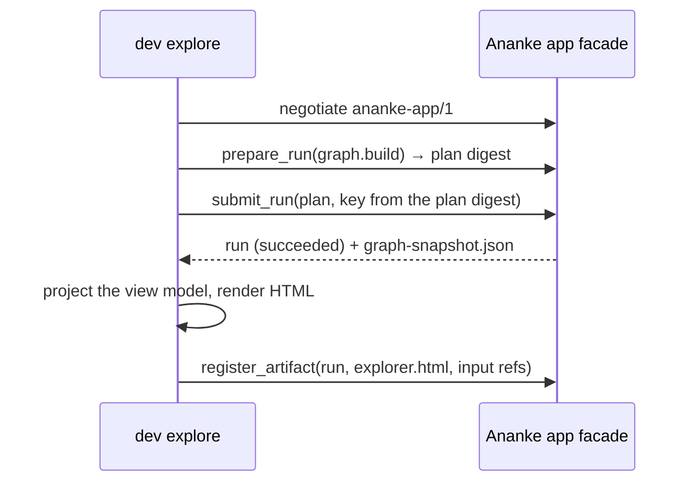

# Architecture

Dev Guru is the product layer of a three-repository system. It turns Ananke's analysis into developer experiences:
commands, an SDK, reports and a local web interface.

## What lives where

| Concern | Dev Guru | Ananke Plexus | Dex Trove |
| --- | --- | --- | --- |
| Code, data and API understanding | explorer views, reports | parsers, graph, impact, contracts | supporting skills |
| Workflows | guided forms, later a visual editor | resolve, compile, schedule, resume | portable recipes |
| Quality and testing | findings and test-plan views | scanners, test runs, gates | review and testing guidance |
| Run state and evidence | links and projections only | canonical | none |
| Product state | preferences, saved views, report assets, UI drafts | none | none |

## The client port (`dev_guru.client`)

- `connect(transport)` returns an `AnankeClient` for exactly one transport. Today that's `in-process`, which calls
  the installed `ananke-plexus` package through its public facade. Planned: `process` (an isolated, versioned Ananke
  executable over structured JSON) and `gateway` (the authenticated loopback API behind the web interface).
- `info()` negotiates: the installed version against `SUPPORTED_ANANKE`, plus a probe of each capability Dev Guru
  calls. Required capabilities missing, or a version out of range, is an error with a stable code.
- `graph_data(workspace)` runs Ananke's `graph.build` through the **app facade** (protocol `ananke-app/1`): the
  run is idempotent for unchanged code, and the graph is read from the run's `graph-snapshot.json` artifact, whose
  digest is checked. `graph_summary(workspace)` is a bounded projection of the same data.
- `register_artifact(...)` records what Dev Guru rendered (the explorer HTML) back into that run, with its inputs.
  Dev Guru is the external renderer, and Ananke keeps the evidence.
- `discover_capabilities(workspace)` lists capabilities from every configured source through Ananke's provider
  port. `learning_candidate(workspace, name)` returns Ananke's view of a learning candidate for review.

Domain results are never computed by Dev Guru. Presentation computation (layout, template rendering, client-side
filtering of already-loaded data, form validation) is Dev Guru's.

## Deployment shapes

1. **Python package**: Dev Guru calls the installed Ananke in the same environment. No JavaScript tooling is needed
   at runtime.
2. **Isolated harness**: Dev Guru calls a versioned Ananke executable through structured JSON, when dependencies
   must stay apart.
3. **Local web app (later)**: Dev Guru serves precompiled UI assets and a loopback API; every domain action routes to
   Ananke.

Each run records the transport it used. See [How Dev Guru talks to Ananke](ananke-client.md).
