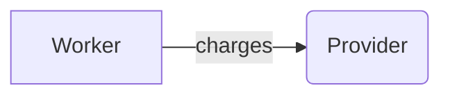

# Diagrams from documents and code

`dev diagram` draws the relationships a document **states**, and every edge cites the line it came from:

```bash
dev diagram docs/payments.md                     # writes docs/payments.svg
dev diagram docs/payments.md --model model.json  # also write an editable model
dev diagram docs/payments.md --from-model model.json -o edited.svg
dev diagram docs/payments.md --static            # no animation
```

## What it reads

Only explicit statements, so text in a document can't talk it into adding a relationship:

````markdown
- API -> Queue: enqueues payment jobs
- Worker --> Queue: pulls jobs



| From | To | Relation |
| --- | --- | --- |
| Ledger | Reports | feeds |
````

Prose and other code blocks are ignored. If a document has no explicit relationships, the command says so and draws
nothing. No model is involved.

## Citations and hypotheses

Hover an edge to see its file and line. You can edit the model to add or remove relationships, but each one is checked
against the document when it's rendered. The cited line must exist and name both ends. A relationship that fails this
is drawn as a **hypothesis**: dashed, with a "?", and counted in the summary. It's never drawn as a fact.

## Safe to embed

The SVG has no scripts, event handlers or external references, and every label is escaped text. The command checks
this before writing. The same document always gives the same bytes. Animation stops under reduced motion or with
`--static`.

## The code graph

`dev diagram` draws what a document says. `dev graph` draws what the code does, from Ananke's graph, and never
more than you ask for:

```bash
dev graph . --level package                          # how the packages depend on each other
dev graph . --focus service.py                       # one file and its neighbours, as Mermaid
dev graph . --focus service.py --depth 2 --budget 80 # one more ring out
dev graph . --level symbol --focus explore -f svg -o explore.svg
```

- **Expanding:** a node marked `+3` has three neighbours left out. The command that draws them is printed to stderr
  (`more: dev graph ... --depth 2 --budget 80`), so you can grow a diagram a step at a time.
- **Edges:** imports and calls between the same two nodes are one edge, labelled `imports · 3 calls`. A call Ananke
  inferred through imports is dashed.
- **Formats:** Mermaid (paste it into Markdown on GitHub or the docs site), SVG (static with `--static`, checked for
  scripts and external references before it's written) and JSON (`dev-guru/subgraph@1`).
- **SDK:** `guru.export(result, output="graph.mmd", format="mermaid", focus="service.py", depth=2)`.

