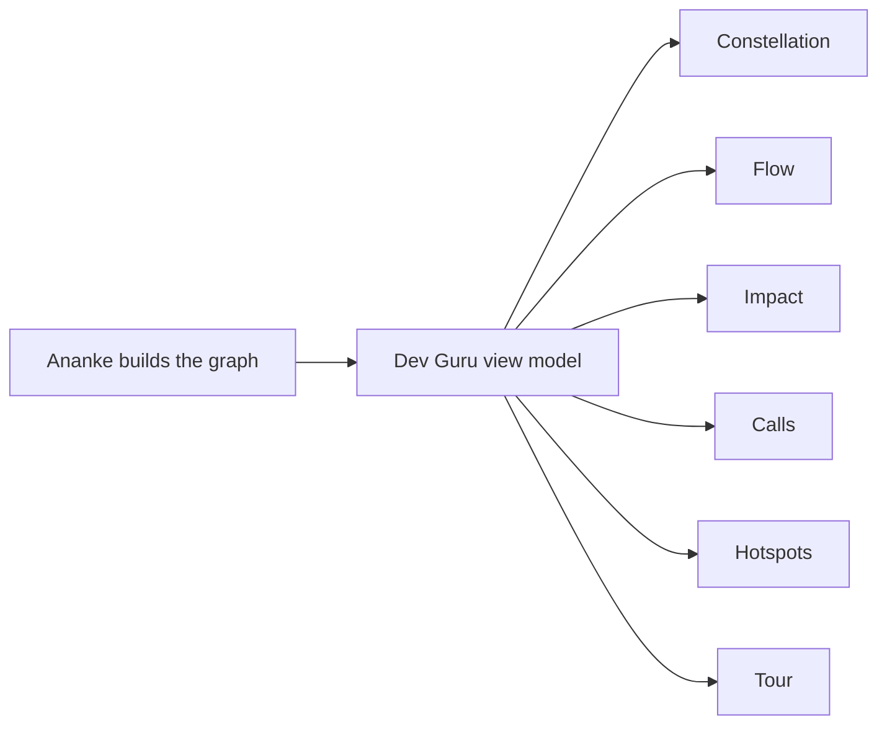

# The explorer

`dev explore` writes one HTML file with 25 views over the same data. Each one answers a different question about
the codebase, and `dev serve` shows the same pages live. Six are drawn from the code graph alone, and the other 19 come
from the repository analysis.

Every view is laid out the same way:

- **The rail, on the left,** lists what's in the view, with a search box and a few places to start.
- **The stage, in the middle,** is a live drawing. Hover anything and what it connects to lights up, with light
  travelling along the lines. Drag to move around, use **+**, **−** and **⤢** to zoom and fit, or hold `Ctrl` or `⌘` and
  scroll.
- **The inspector, on the right,** explains whatever you select, with its source where there is any.
- **Walk through** moves through the view's main items and says what each one is. Any click hands control back to you.

With reduced motion, nothing moves and everything still works.



## The views that come from the analysis

| View | Its stage | Its rail |
| --- | --- | --- |
| Overview | Every view round the repository, coloured by what it found | Each view, with a line about it |
| Code map | Folders, files and functions, with links across folders and to tables | Folders, files and tables |
| End-to-end flows | One flow, which lights up as you step along it | Flows, and calls that lead nowhere |
| Notebooks | How the notebooks feed each other | Notebooks by folder |
| Data | The ERD, with each table's keys lit | Tables, most connected first |
| API pathways | Callers, routes and handlers in three columns | Routes by path |
| Architecture | The inferred CALM model | Components |
| Quality | Files sized by lines, coloured by complexity | Most complex functions, largest files |
| Coverage | Files sized by lines, coloured by coverage | Files, least covered first |
| CVEs | Vulnerable packages round your dependencies | Advisories, worst first |
| Findings | Scanner findings and failing tests, by severity | Failing tests, then findings |
| What's certain | Each view, by how far it can be trusted | Views, with their limits |
| Saving tokens | Each question, and the cheapest tool for it | Questions |
| Code | The code graph at the level you choose | Items by kind |
| Runs | The latest runs, in order | Runs, newest first |
| Capabilities | What your sources offer, by kind | Capabilities by kind |
| Workflows | A canvas you can edit by mouse or keyboard | Starting points, steps and what's offered |
| Documentation | What a Markdown file can become | Markdown files |
| Learning review | How far a candidate has got | Candidates |

Where something isn't known, the stage says so rather than draw it as empty or clean. A report can't start anything, so
actions such as Preview or Analyse ask you to use `dev serve`.

## Embedding a report in a page

Frame a report with `#view=constellation&embed=1` and it shows only the tabs and the stage. Add `&play=1` and it shows each
view in turn until someone clicks, scrolls or presses a key inside it. Reduced motion turns playing off.

## ✦ Constellation: what's here?

Every file is a body in a 3D force-directed graph. Imports act as springs, files repel each other, and each package
pulls its own files together, so the structure of the code becomes the shape in space. Size shows lines of code,
colour shows the package, and nearer bodies are brighter.

- **Drag** the background to orbit, **scroll** to zoom, and use **⤢** (or `F`) to fit everything in view.
- **Drag a file** to pull it: the graph follows and settles again.
- **Hover** a file and its imports and importers light up, with pulses travelling along the connections.
- **Click** to open it in the inspector, and **double-click** to fly to it.
- Import cycles glow rose. When you leave it alone, the graph turns slowly.

It is drawn on a plain canvas by the report itself (no WebGL, no library), and with reduced motion it settles
before the first frame and stays still.

## ⇶ Flow: what depends on what?

Dependencies laid out left to right, from the *entry side* to the *foundations*. Large projects start at
**package** level, with thicker edges for more imports; switch to **files** for detail. Click a package to drill
in. Edges that close a cycle are drawn in rose.

## ◎ Impact: what breaks if this changes?

Pick a file or symbol and its dependents spread out in rings: one hop, two hops, and so on. For a file, that's
everything that imports it or calls into it. For a function, it's every caller. For a class, it's callers of the
class and of its methods. The headline gives the blast radius as a number and as a share of the workspace.

## ƒ Calls: who calls in, and what does it call?

The symbols of the selected file sit in the middle, with callers on the left and callees on the right. Calls and
base classes are inferred statically by Ananke, so dynamic dispatch isn't shown. Read them as strong hints, not
proof.

## ▦ Hotspots: where is change expensive?

A treemap with area for lines of code and colour for how many files import it. Large files that many others depend
on are where changes cost the most and tests matter most.

## ☄ Tour: show me around

A narrated walk: the overview, the biggest packages, entry points, the most depended-on file, the largest file,
cycles, external dependencies, and finally what the map can't see. Use the arrow keys or the buttons; it pauses
when you ask it to.

## Every page of `dev serve`, in the file

The tabs after Tour are the pages of [`dev serve`](repository-views.md): Overview, Code map, End-to-end flows, Notebooks, Data, API pathways, Architecture, Quality, Coverage, CVEs, Saving tokens, Code, Runs, Capabilities, Workflows, Documentation and Learning review. They're the same pages, with a recording of what they ask for, so you can step through a flow or read a table's fields with nothing running.

A file can't start anything, so its buttons for analysing, checking for vulnerabilities, starting a run, previewing a workflow and building a deck say to use `dev serve`. It makes no network requests, so CVEs say they weren't checked unless you ask when you make it:

```bash
dev explore . -o report.html --check-vulnerabilities
```

That looks up dependencies at osv.dev, sending package names and versions, and nothing else. With `--profile public`, these pages are left out, and a Repository tab keeps only counts. On a very large repository, the views of single files stop at a limit, and a page says if it can't show you one.

## The inspector

Pick anything to see its path, docstring, signature, source with line numbers, and every connection, each one
clickable.

- **Ask for deeper analysis** downloads a small request file. You run it with Dev Guru or Ananke; the report never
  runs anything itself.
- **Download this view's state** (in the command palette) saves what you're looking at as JSON.

## What a report can't tell you

Every report lists its limitations under *About*:

- It's static analysis of Python source; nothing is executed.
- Calls are inferred through imports.
- External modules are named, not analysed.
- Large projects may have symbols omitted to keep the file bounded.
