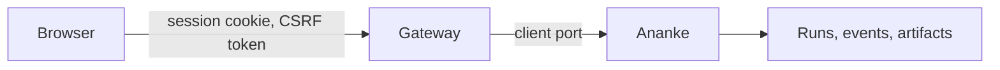

# The local gateway

`dev serve` starts a small web server on your computer and opens a web interface to what Ananke computes. It comes with
[Dev Guru on PyPI](https://pypi.org/project/dev-guru/) and needs no Node: the page is plain files inside the package.

```bash
dev serve                     # this folder
dev serve ../shop ../billing  # the folders a browser may reach
dev serve --no-open --port 8765
```

It prints a link that works once. Opening it signs your browser in until the server stops.

It opens on the explorer, the same as a report: Constellation, Flow, Impact, Calls, Hotspots and Tour, then every page
below as a tab. The pages are live, so analysing, checking for vulnerabilities, previewing a workflow and building a
deck all work. The pages alone are at `/app`. If the folder has no code graph yet, the explorer offers to build one:
reading a page never starts anything.



The gateway holds no domain logic. Ananke compiles, authorizes, runs and records, and it rechecks everything itself.

## The web interface

| Page | What you can do |
| --- | --- |
| **Overview** | See the Ananke version, the Dev Guru version, the run count and what the harness can run |
| **Runs** | Build the code graph, and see this workspace's runs, newest first |
| **A run** | Follow its state, events, warnings and artifacts as they happen, download artifacts, and cancel it |
| **Code** | Browse the code graph by folder, file or symbol, within a node budget, and see where every link went |
| **Code map, End-to-end flows, Data, API pathways, Architecture, Quality, Coverage, CVEs, Saving tokens** | See how a repository works. Read [Repository views](repository-views.md) |
| **Workflows** | Put capabilities in order, and see what would run or what's wrong. Previewing runs nothing |
| **Documentation** | Make a deck or a diagram from a Markdown file, as a download |
| **Learning review** | See what was learned, its evidence and how it would change each destination. It's read-only |
| **Capabilities** | Search what your sources offer. Being listed doesn't mean a capability is trusted or will run |

If you started `dev serve` with several folders, the picker at the top chooses between them.

**Workflows**, **Quality**, **Documentation** and **Learning review** aren't in this version. They're in the navigation
under that heading, and each names the commands that work today. See the
[roadmap](../roadmap.md) for what's planned.

### Runs keep going without the page

A run lives in Ananke, not in your tab:

- **Reload or close the tab**, and opening the run's address again shows the same run, with each event once.
- **Lose the connection**, and a note says so while the page retries. When it's back, the page picks up after the last
  event it saw. If Ananke has dropped old events by then, the list says which ones.
- **Cancel** is one button, and nothing else cancels a run: not leaving the page, closing the tab or losing the
  connection. A cancelled run stays cancelled, even if the work behind it was already finishing.

### Keyboard and small screens

The first `Tab` reaches a skip link to the content, every control works from the keyboard, focus is always visible, and
moving to a page puts focus on it. Every page fits a phone without sideways scrolling. The theme switch is remembered in
that browser.

### Hostile text stays text

File names, messages and anything else from the server reach the page only as text, so a file called
`.py` is displayed and does nothing. Links are built only from fixed starting points. The
page loads nothing from any other site, and the content policy allows no inline code.

## Why a local server needs a login

Any web page you visit can send requests to a port on your computer. So a request has to prove it came from your session:

| Protection | What it stops |
| --- | --- |
| Listens on `127.0.0.1` only, with no option to change it | other computers |
| `Host` must name this server | a hostile site rebinding its DNS name to your computer |
| Single-use link, then an `HttpOnly`, `SameSite=Strict` cookie | other programs and pages guessing their way in, and links reused from history |
| Changes need a same-origin `Origin`, a CSRF token and a JSON body | a page on another site submitting a form or script |
| No CORS headers | other sites reading a response |
| Workspaces are named by an opaque id | any request reaching a folder you didn't list |
| No route takes a command or a path to run | turning the gateway into a remote shell |
| Artifacts always download, with `nosniff` and a sandbox policy | an artifact running as a page on this origin |
| A fixed list of interface files, no path from a request ever reaches the disk | a request reading other files |
| A content policy that allows only this server's own files, with no inline code | injected script running, and other sites framing the page |

**What it doesn't protect against:** other programs running as your user can read the terminal output and the browser's
cookies. The traffic is plain HTTP over loopback, which doesn't leave your computer. Don't put a proxy in front of it to
share it: it's built for one person on one computer.

## API

Everything needs the session cookie. Every `POST` also needs the `X-Dev-Guru-CSRF` header from `/api/v1/session`.

| Route | Purpose |
| --- | --- |
| `GET /api/v1/session` | the CSRF header name and token |
| `GET /api/v1/health` | gateway version and harness compatibility |
| `GET /api/v1/workspaces` | the folders given at start, with their ids |
| `GET /api/v1/capabilities?workspace=ID` | what the harness offers |
| `GET /api/v1/sources?workspace=ID&q=WORDS` | capabilities from your sources |
| `GET /api/v1/code?workspace=ID` | the code graph; also `path`, `q`, `kinds`, `budget`, `collapse`, `depth` |
| `POST /api/v1/plans/prepare` | preview a workflow draft: `{workspace, draft}`. Runs nothing |
| `POST /api/v1/runs` | start a run: `{workspace, kind, parameters, idempotency_key}`. Answers `202` straight away |
| `GET /api/v1/runs?workspace=ID` | the latest 100 runs, newest first, and the total |
| `GET /api/v1/runs/RUN?workspace=ID` | a run's state |
| `GET /api/v1/runs/RUN/events?workspace=ID&after=N` | events after number `N` |
| `POST /api/v1/runs/RUN/cancel` | cancel: `{workspace}` |
| `GET /api/v1/runs/RUN/artifacts?workspace=ID` | a run's artifacts |
| `GET /api/v1/runs/RUN/artifacts/NAME?workspace=ID` | download one, after Ananke checks its digest |

Run state lives in Ananke, not the gateway. So a reloaded tab or a second tab sees the same run, and sending the same
`idempotency_key` again returns the same run.

Events are polled. To pick up where you left off, ask for those after the last `seq` you saw. If old events have been
dropped, the response has a `gap` and the current run.

## Errors

```json
{"ok": false, "error": {"code": "STALE_PLAN", "message": "…", "retryable": true}}
```

Branch on `code`. What Ananke refuses keeps Ananke's own code. A retryable refusal is `503`, an unknown run `404`, and a
conflict or stale plan `409`, unless it's marked retryable. An unexpected error is `500` with no internal detail.

## Limits

- A run that was executing when the server stopped stays `running`, and one still waiting stays `queued`. Nothing resumes
  them, so the interface keeps showing them as going. You can cancel them.
- At most two runs execute at a time. Others wait.
- Cancelling marks the run straight away. Work already in a step finishes behind it without changing the run's state, and
  a workflow stops before its next step.
