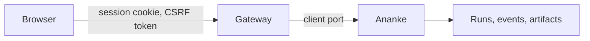

# The local gateway

`dev serve` starts a small web server on your computer, so a browser can reach Ananke through Dev Guru. It's the base for
the web interface. **There's no web interface in this version yet:** the page it serves says so, and you use the API.

```bash
dev serve                     # this folder
dev serve ../shop ../billing  # the folders a browser may reach
dev serve --no-open --port 8765
```

It prints a link that works once. Opening it signs your browser in until the server stops.



The gateway holds no domain logic. Ananke compiles, authorizes, runs and records, and it rechecks everything itself.

## Why a local server needs a login

Any web page you visit can send requests to a port on your computer. So a request has to prove it came from your session:

| Protection | What it stops |
| --- | --- |
| Listens on `127.0.0.1` only, with no option to change it | other computers |
| `Host` must name this server | a hostile site rebinding its DNS name to your computer |
| Single-use link, then an `HttpOnly`, `SameSite=Strict` cookie | other programs and pages guessing their way in, and links reused from history |
| Changes need a same-origin `Origin`, a CSRF token and a JSON body | a page on another site submitting a form or script |
| No CORS headers | other sites reading a response |
| Workspaces are named by an opaque id | any request reaching a folder you didn't list |
| No route takes a command or a path to run | turning the gateway into a remote shell |
| Artifacts always download, with `nosniff` and a sandbox policy | an artifact running as a page on this origin |

**What it doesn't protect against:** other programs running as your user can read the terminal output and the browser's
cookies. The traffic is plain HTTP over loopback, which doesn't leave your computer. Don't put a proxy in front of it to
share it: it's built for one person on one computer.

## API

Everything needs the session cookie. Every `POST` also needs the `X-Dev-Guru-CSRF` header from `/api/v1/session`.

| Route | Purpose |
| --- | --- |
| `GET /api/v1/session` | the CSRF header name and token |
| `GET /api/v1/health` | gateway version and harness compatibility |
| `GET /api/v1/workspaces` | the folders given at start, with their ids |
| `GET /api/v1/capabilities?workspace=ID` | what the harness offers |
| `GET /api/v1/sources?workspace=ID&q=WORDS` | capabilities from your sources |
| `GET /api/v1/code?workspace=ID` | the code graph; also `path`, `q`, `kinds`, `budget`, `collapse`, `depth` |
| `POST /api/v1/plans/prepare` | preview a workflow draft: `{workspace, draft}`. Runs nothing |
| `POST /api/v1/runs` | start a run: `{workspace, kind, parameters, idempotency_key}`. Answers `202` straight away |
| `GET /api/v1/runs/RUN?workspace=ID` | a run's state |
| `GET /api/v1/runs/RUN/events?workspace=ID&after=N` | events after number `N` |
| `POST /api/v1/runs/RUN/cancel` | cancel: `{workspace}` |
| `GET /api/v1/runs/RUN/artifacts?workspace=ID` | a run's artifacts |
| `GET /api/v1/runs/RUN/artifacts/NAME?workspace=ID` | download one, after Ananke checks its digest |

Run state lives in Ananke, not the gateway. So a reloaded tab or a second tab sees the same run, and sending the same
`idempotency_key` again returns the same run.

Events are polled. To pick up where you left off, ask for those after the last `seq` you saw. If old events have been
dropped, the response has a `gap` and the current run.

## Errors

```json
{"ok": false, "error": {"code": "STALE_PLAN", "message": "…", "retryable": true}}
```

Branch on `code`. What Ananke refuses keeps Ananke's own code. A retryable refusal is `503`, an unknown run `404`, and a
conflict or stale plan `409`, unless it's marked retryable. An unexpected error is `500` with no internal detail.

## Limits

- A run that was executing when the server stopped stays `running`. Nothing resumes it.
- At most two runs execute at a time. Others wait.
- Cancelling takes effect between steps.
